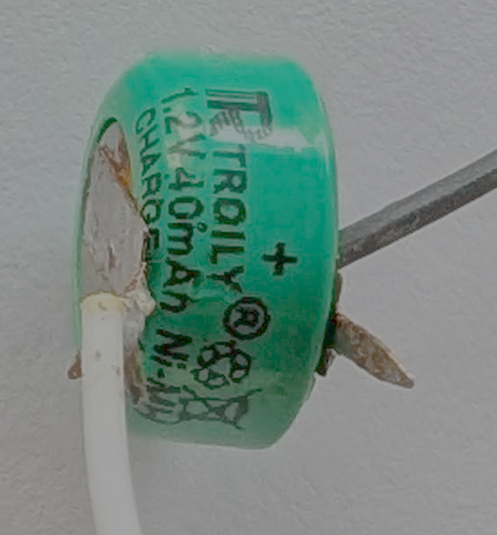
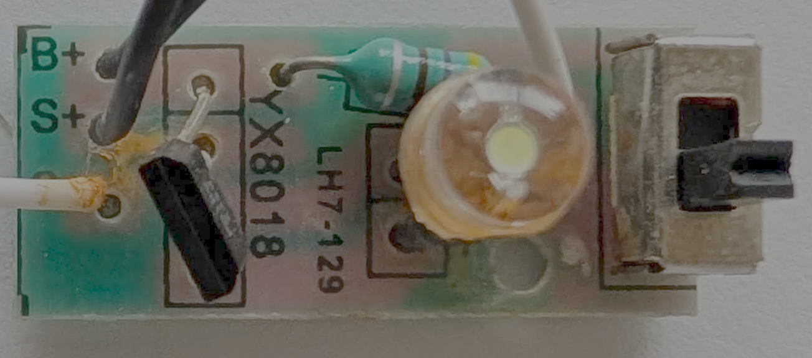
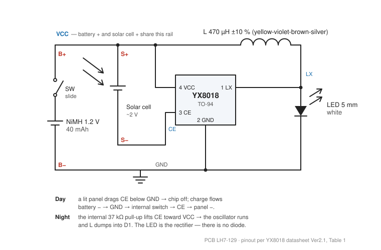
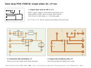

## Solar lamp 

Datasheets about **YX8018**, a solar lawn lamp boost control chip, which is suitable for a solar lawn lamp powered by a 1.2V rechargeable battery in series

- https://www.datasheetcafe.com/yx8018-datasheet-pdf/
- https://www.datasheetcafe.com/wp-content/uploads/2024/03/yx8018-led-controller.pdf

### 🔍 Circuit Components

| Component | Inscription / Markings | Exact Identification & Specifications |
| :--- | :--- | :--- |
| **1. Main Controller IC** | `YX8018` | **YX8018 Solar LED Driver IC** (TO-94 package, 4 pins). It is a switch-mode power supply (SMPS) designed for LED lighting system. It handles the battery charging during the day via the solar panel and boosts the $1.2\text{ V}$ battery up to $\sim 3\text{ V}$ at night to drive the LED. |
| **2. Axial Inductor** | Color bands (green/teal body): Yellow, Violet, Brown, Silver | **Axial Inductor $470\ \mu\text{H}$ ±10 %** (fourth band confirmed silver by eye). Inductor color codes are read in µH: Yellow = 4, Violet = 7, Brown = $\times 10$, Silver = ±10 % tolerance. ±10 % puts the real part between 423 and 517 µH, i.e. ≈2.4–3.0 mA input current. |
| **3. Battery** | `TROILY` `1.2V 40mAh Ni-MH` | **$1.2\text{ V}$ 40 mAh Ni-MH Button Cell / Coin Cell Rechargeable Battery** (with solder tabs). |
| **4. LED** | Standard 5mm LED - 3V | **$5\text{ mm}$ DIP White / Warm White LED** (Clear dome lens). |
| **5. Switch (Interruptor)** | Side slider | **Miniature Slide Switch (SPDT)**, PCB right-angle mount. |
| **6. PCB Board** | `LH7-129` | **Single-sided Custom PCB** for solar lawn light circuits. Marked with `B+` (Battery $+$) and `S+` (Solar panel $+$). |

Epoxy square solar panel : +/- 30x30 mm => delivering 2.4V / 17mA

https://ez.analog.com/adiacademy/university-program/a/studentzone-articles/SA1116/hacking-an-led-solar-garden-light
---

### ⚡ Circuit Schematic

**Pinout** (datasheet Ver2.1, Table 1 — TO-94):

| Pin | Name | Meaning | Function |
|---|---|---|---|
| 1 | `LX` | inductor, e**X**ternal | Power switch drain — the bare drain of the internal NMOS. Drives `L` and the LED anode. |
| 2 | `GND` | ground | Battery −. (The datasheet's "land" is a mistranslation of 地.) |
| 3 | `CE` | **C**hip **E**nable | Solar cell −. Chip enable *and* the charging-current return. |
| 4 | `VCC` | **V**oltage, **C**ommon **C**ollector | Battery + **and** solar cell + — one shared rail. |

**How it works:**

- **The shared rail:** there is no separate "solar in" pin. Solar + and battery + both land on `VCC`; the solar cell's − goes to `CE`. That one wire does two jobs at once.
- **Day:** the lit panel, with its + clamped at `VCC`, drags `CE` below GND. An internal comparator (≈0.29–0.36 V band at `VIN` = 1.2 V, ~70 mV hysteresis so it doesn't flicker at dusk) shuts the chip down. Charging current then flows battery − → GND → an internal switch → `CE` → panel −.
- **Night:** the panel generates nothing, so an internal 37 kΩ pull-up lifts `CE` toward `VCC` and the oscillator runs. The NMOS shorts `LX` to GND, storing energy in `L`; when it releases, `LX` flies above `VCC` until the LED clamps it at ~3 V. **The LED is the rectifier** — that's why there's no diode. ~316 kHz with 82 µH.
- **Brightness** is set purely by `L` — no feedback loop, no sense resistor (Table 1, p.8): 220 µH → 5.8 mA, 82 µH → 14.8 mA, 22 µH → 51.4 mA. The fitted 470 µH extrapolates to ≈3 mA: dim, but right for a 40 mAh cell.
- **Switch:** the slide switch cuts the battery (`B+`) from the `VCC` rail, turning the lamp fully off. It also stops charging — the datasheet's Figures 7/8 add a Schottky if you want charging to continue with the switch off.

> ℹ️ Colour-changing LEDs need a Schottky + 10 µF added at `LX` (datasheet Figures 3/4): their internal controller needs real DC and would reset on every pulse.

---

### 🖨️ PCB Layout (DIY etching)

Single-sided board, **38 × 27 mm**, through-hole parts, copper on the bottom.

**Make the board:**

1. Open [`img/solar-lamp-pcb.svg`](img/solar-lamp-pcb.svg) in a browser or Inkscape and print it at **100 % / actual size** (turn off "fit to page"). Measure the 20 mm scale bar to check the print.
2. Use **panel 1** (black copper). The copper is on the bottom layer, so print it **as shown, not mirrored**, for toner transfer (laser printer + glossy paper + iron) or UV photoresist film.
3. Etch (ferric chloride or sodium persulfate), clean off the toner, then drill: **0.8 mm** for the parts, **1.0 mm** for the four wire pads.
4. Fit the parts using **panel 2** (component side), then solder looking at **panel 3** (copper side).

**Connections:**

| Pad | Connects to |
|---|---|
| `S+` | Solar cell **+** → the `VCC` rail (same node as the battery +) |
| `S−` | Solar cell **−** → `CE`. **This is not ground.** |
| `B+` / `B−` | NiMH battery + / −. `B−` is the only ground. |
| SW (3 pads) | Slide switch SS12D07. Left pin = `B+`, middle = common. The right pin is not connected. |
| L | 470 µH axial inductor (pads 10.16 mm apart) |
| A / K | LED anode (long leg) / cathode (short leg, flat side) |

> ⚠️ **Before etching:**
> - The YX8018 pads are spaced at 2.54 mm, in the order `4 VCC, 3 CE, 2 GND, 1 LX` left to right — the TO-94 goes in **rotated 180°**, which is what lets the board route on a single copper layer. The **square pad is pin 1 (LX)**, and the silkscreen prints the pin names under the pads.
> - The TO-94 legs are 1.27 mm apart, so spread them gently to reach the 2.54 mm pads. If you order the board instead of etching it, the KiCad project also carries a native 1.27 mm footprint (`YX8018_TO94_P1.27mm`).
> - The switch pads assume a **3 mm pitch** (SS12D07). Measure your switch.

---

### 🏭 Order the PCB online

A KiCad project for this board is in [`../kicad`](../kicad/solar-lamp-ai/README.md). It has a ready-to-upload Gerber zip: [`../kicad`](../kicad/solar-lamp-ai/solar-lamp-gerbers.zip).

1. Upload `solar-lamp-gerbers.zip` to JLCPCB, PCBWay or Aisler.
2. Settings: 2 layers, 38 × 27 mm, FR-4, 1.6 mm, HASL, qty 5, no assembly.

The project is verified against KiCad 10.0.8: ERC 0 errors / 0 warnings, DRC 0 errors, 0 unconnected pads. The pinout matches the datasheet; see the project [README](../kicad/solar-lamp-ai/README.md) for the one cosmetic DRC warning that KiCad raises for any rotated footprint.

---

### 🛒 Replacement / Procurement Guide

If you are looking to replace or rebuild this exact solar garden light circuit, here is what to search for:

1. **IC Controller:** Search for **"YX8018 TO-94"** or **"YX8018 solar LED driver chip"** (often sold in packs of 10 on AliExpress, eBay, or Amazon).
2. **Inductor:** Search for **"Axial Inductor 470uH 0307"** (color code yellow-violet-brown-gold).
3. **Battery:** Search for **"1.2V Ni-MH 40mAh button cell with solder tabs"** or **"1.2V 80mAh NiMH coin cell"**. (You can also upgrade to a larger $1.2\text{ V}$ AAA NiMH cell for significantly longer run time).
4. **Slide Switch:** Search for **"Mini Slide Switch SS12D07"** or similar right-angle 3-pin PCB slide switch.
5. **Solar Panel (External Connection):** The `S+` and `S-` (GND) pads are meant to connect to a **$2\text{ V}$ Solar Cell / Photovoltaic panel**.