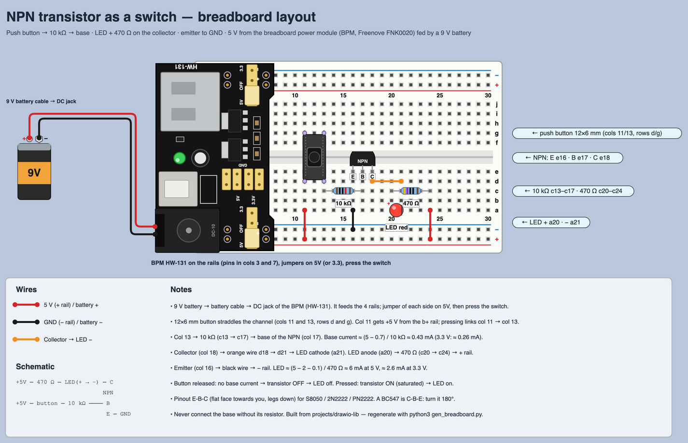

# NPN transistor as a switch

A small current into the **base** of an NPN transistor lets a much larger current flow from the
**collector** to the **emitter**. In this circuit, a push button sends current into the base, and the
transistor turns an LED on.

## Schematic

```
+5 V ── 470 Ω ── LED (+ → −) ── C
                               NPN
+5 V ── button ── 10 kΩ ────── B
                               E ── GND
```

## Parts

| Qty | Part | Notes |
|---|---|---|
| 1 | Half breadboard (30 columns) | |
| 1 | NPN transistor, TO-92 | S8050 (Freenove kit), 2N2222, PN2222, BC547… |
| 1 | Push button 12 × 6 mm (Freenove FNK0020 kit) | 4 legs; the 2 legs on the same side are always linked |
| 1 | Resistor 10 kΩ (brown-black-black-red · brown) | base resistor, 1 % 5-band |
| 1 | Resistor 470 Ω (yellow-violet-black-black · brown) | LED current limit, 1 % 5-band |
| 1 | Red LED | |
| 1 | Breadboard power module (**BPM**) HW-131 of the Freenove FNK0020 kit | 9 V → 5 V / 3.3 V, one `5V OFF 3.3` jumper per side, push switch |
| 1 | 9 V battery + battery cable with DC plug | |
| 4 | Jumper wires | |

## Circuit



## How it works

| | Button released | Button pressed |
|---|---|---|
| Base current | 0 | (5 − 0.7) / 10 kΩ ≈ **0.43 mA** |
| Transistor | OFF (cutoff) | ON (saturation) |
| LED current | 0 | (5 − 2 − 0.1) / 470 Ω ≈ **6 mA** |

The transistor needs a base current of about 6 mA / β. β is 100 or more for these transistors, so
0.43 mA is enough to switch it fully on (saturation).

**5 V or 3.3 V?** The jumper of the power module selects the rail voltage:

| Rail voltage | Base current | LED current (470 Ω) |
|---|---|---|
| 5 V | ≈ 0.43 mA | ≈ 6 mA (bright) |
| 3.3 V | ≈ 0.26 mA | ≈ 2.6 mA (dimmer) |

At 3.3 V the circuit also works; use 220 Ω for a brighter LED (≈ 5 mA). 3.3 V is the level of an
ESP32 GPIO, so it is a good test before driving the base from a microcontroller.

## How to calculate the resistor for B

Start **from the load** (the LED) and work back to the base - B. There are 4 steps.

### The part of the circuit involved
```
Vcontrol (5 V through the button) ──► B
                                      NPN (C ← LED ← 470 Ω ← +5 V)
                                      E ── GND
```
The current through "5V - button" flows into the **B - base** and leaves through the **E emitter** to **GND**.

### Step 1: the load current (IC)

When the transistor is saturated, it behaves like a wire. The
[onsemi SS8050 datasheet](https://www.onsemi.com/download/data-sheet/pdf/ss8050-d.pdf) (top mark S8050) gives VCE(sat) in two places:

- table "Electrical Characteristics": **VCE(sat) max 0.5 V**, but at IC = 800 mA / IB = 80 mA, far above
  this circuit;
- figure 3 (typical, IC = 10 × IB): **VCE(sat) ≈ 0.02–0.025 V** from 0.1 mA to about 10 mA.

At IC ≈ 6 mA the real value is about 0.02–0.03 V. The calculation below uses **VCE(sat) ≈ 0.1 V**, a
rounded-up value: the difference is only (0.1 − 0.025) / 470 Ω ≈ 0.16 mA. The current is then set by
the LED and its resistor:

**IC = (Vsupply − VLED − VCE(sat)) / R_LED**

In this circuit: IC = (5 − 2 − 0.1) / 470 ≈ **6 mA**

### Step 2: the minimum base current (IB min)
Use the **minimum gain** from the datasheet, never the typical value:

**IB min = IC / hFE min**

With an S8050 **D** (hFE2 grade D = 160 to 300 in the datasheet): IB min = 6 mA / 160 ≈ **0.04 mA**

The marking on the transistor tells the grade: e.g. `S8050` / `D331` = grade **D**, then `331` = year + work
week (onsemi format `YWW`; other makers use their own codes).

### Step 3: add a margin to saturate the transistor fully
The gain changes with temperature and from one transistor to another. So multiply by an
**overdrive factor k**:

**IB = k × IB min**, with k between 2 and 10 (5 is a common choice)

With k = 5: IB = 5 × 0.04 ≈ **0.2 mA**

Another common method, simpler and safer: **IB = IC / 10**, i.e. 0.6 mA. It does not depend on the
gain of the transistor.

### Step 4: the base resistor (RB)
Between the control signal and the base, the base-emitter junction "uses" about 0.7 V (VBE; datasheet
figure 3 gives VBE(sat) ≈ 0.6–0.7 V at low current, figure 4 VBE(on) ≈ 0.65 V at 6 mA). So
(Vcontrol − 0.7 V) is left across RB:

**RB = (Vcontrol − VBE) / IB**

In this circuit:
- with IB = 0.2 mA: RB = (5 − 0.7) / 0.0002 ≈ **21 kΩ**
- with IB = 0.6 mA: RB = 4.3 / 0.0006 ≈ **7.2 kΩ**

Then choose **a standard value between the two**, rounding down, which gives more base current. The
**10 kΩ** (IB ≈ 0.43 mA) is therefore a good choice.

### Two checks
1. **Can the control signal supply IB?** With a button wired to 5 V, there is no problem. With an
   ESP32 pin (3.3 V, a few mA), IB must stay small: (3.3 − 0.7) / 10 kΩ ≈ 0.26 mA, which is fine.
2. **Don't make the resistor too small.** With no RB, or a very small one, nothing limits the base
   current, and the transistor or the control pin can burn out.

### One-line summary
**RB = (Vcontrol − 0.7) / (k × IC / hFE min)**, with k ≈ 5, or more simply
**RB ≈ (Vcontrol − 0.7) / (IC / 10)**.

## Next steps

- Replace the button with an ESP32 GPIO pin: 3.3 V or 5 V → 1 kΩ to 10 kΩ → base.
- Replace the LED with a relay, a buzzer or a motor. Add a flyback diode on an inductive load.
- See [`../../photoresistor`](../../photoresistor): the same transistor, driven by a light sensor.

## Files

| File | Content |
|---|---|
| `gen_breadboard.py` | Generates the diagram from the parts in [`../../drawio-lib`](../../drawio-lib) |
| `npn-switch-breadboard.drawio` | Diagram you can edit in draw.io |
| `npn-switch-breadboard.png` | Image export |

To regenerate the diagram and the image:

```sh
python3 gen_breadboard.py
drawio -x -f png -s 1 -b 10 -o npn-switch-breadboard.png npn-switch-breadboard.drawio
```

## References

- [onsemi — SS8050 NPN Epitaxial Silicon Transistor (datasheet, PDF)](https://www.onsemi.com/download/data-sheet/pdf/ss8050-d.pdf): ratings, hFE grades B/C/D, VCE(sat) and VBE curves (figures 2–4)
- [YouTube — How to Use an NPN Transistor to Switch on an LED](https://www.youtube.com/watch?v=8ZEQEV-Stkc)
- [All About Circuits — Bipolar Transistor as a Switch (lab)](https://www.allaboutcircuits.com/textbook/experiments/chpt-5/transistor-as-a-switch/)
- [DIY Engineers — How to use the 2N2222 transistor (NPN)](https://www.diyengineers.com/2020/12/17/2n2222-transistor-npn/)

